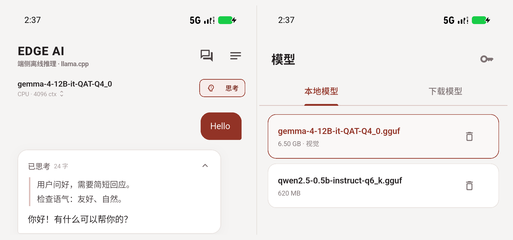

# Edge AI

Edge AI 是一个完全离线的 Android 端侧大模型聊天应用。应用使用 Flutter 构建界面，通过 Dart FFI 调用静态链接了 llama.cpp 的 `libedge_ai.so`，在设备本地完成模型加载、推理、多模态处理和 KV 状态缓存。

- 仓库：<https://github.com/iYeXin/EdgeAI>
- 发布页：<https://github.com/iYeXin/EdgeAI/releases>
- 原生 C ABI：**v5**
- 构建目标：**arm64-v8a**（真机）、**x86_64**（模拟器）

## 核心亮点

- **完全离线**：模型、推理、会话与 KV state 均保存在设备本地。
- **Vulkan + CPU 双后端**：同一套 native ABI，运行时切换；Mali-G925 上 Qwen3-1.7B Q6_K 解码约 23 tok/s。
- **长会话可恢复**：真机 1671 token 历史命中 1265 token 前缀，冷启动 prefill 从约 19 s 降到约 5 s。
- **32k 上下文 + 自适应内存**：按当前可用内存选 ctx，低内存自动降级，加载前做模型 + KV + headroom 准入。
- **真正的会话树**：消息以 `id/parentId` 持久化，编辑与重新生成创建分支，历史节点保留。
- **多模态与模型管理**：GGUF + `mmproj`、多图、ModelScope/HF 搜索、分片下载、SHA256、Token。

## 1. 项目状态

| 项目 | 说明 |
| --- | --- |
| UI | Flutter 3.47.8 / Dart 3.13.7 |
| 推理后端 | llama.cpp，CPU + Vulkan |
| 多模态 | `mtmd`，GGUF + `mmproj` |
| 最低 Android | 由 Flutter `flutter.minSdkVersion` 决定 |
| 编译 SDK | Android 36 |
| NDK | 28.2.13676358 |
| CMake | 4.1.2 |
| Vulkan SDK | 1.4.363.0（本地 Windows 构建） |
| llama.cpp | `aa588a3`，Git submodule |
| 签名 | 当前 release APK 使用 debug keystore |

当前已完成的能力包括：扁平树会话、分支切换、思考模式、系统提示词、文本/多模态 KV state、前后台模型生命周期、自适应上下文、模型搜索与下载、功耗估算。

## 2. 界面

主界面采用栗色 `#923326` 与暖白画布，底部三页通过 `IndexedStack` 保持状态：

- **聊天**：会话树、分支、Markdown、多图、思考开关、系统提示词
- **模型**：本地模型、Hub 搜索、下载队列、Token、分片、SHA256
- **设置**：推理参数、KV 缓存、功耗显示

模型在后台加载，模型页与设置页保持可用；长会话启动后会预加载当前 state。

系统返回采用标签感知策略：先关闭页面内弹层；模型页/设置页返回聊天页；聊天页再次返回才退出应用。



*左：聊天与思考内容；右：本地模型管理。*

## 3. 功能说明

### 3.1 聊天与会话

- 消息以扁平树持久化：每个节点保存 `id` 与 `parentId`，会话保存 `activeLeafId`
- 编辑用户消息时，在同一父节点下创建新分支
- 重新生成时，在同一提问下创建 assistant 兄弟节点
- 切换分支时保留历史节点；旧版线性会话自动迁移为扁平树
- 长按任意消息打开操作：复制、编辑、重新生成、切换分支
- 消息文本可选中复制；助手 Markdown 渲染，用户输入保持纯文本
- 编辑/重新生成会重新标记 assistant 为 streaming，确保流式事件写入对应节点

### 3.2 思考模式

聊天页模型栏右侧提供独立的「思考」开关，状态保存到会话索引。

- 通过 native Jinja `enable_thinking` 传给模型 chat template
- 适用于支持该参数的模型/模板
- 开关状态保存到 `sessions.json`
- 生成期间输入框保持可用，发送按钮切换为停止
- Enter 插入换行，发送使用输入框右侧按钮
- 模型加载与预热期间输入框保持可用，发送按钮暂时禁用

输出中的常见思考标记会被自动识别：

- DeepSeek / Qwen 风格 think 标记
- `<thinking>...</thinking>`
- `<|thinking|>...</|thinking|>` 以及 `</|thinking|>` 变体
- `[THINK]...[/THINK]`
- `<reasoning>...</reasoning>`

渲染时思考内容与最终回答分离：

- 生成中显示「思考中」，完成后显示「已思考」
- 思考内容使用左侧细线与弱化文字展示
- 默认折叠，用户可展开；生成完成后自动收起，手动展开过则保留
- 原始带标签文本完整保存在会话 JSON 中，渲染层负责拆分

### 3.3 系统提示词

聊天页右上角可直接编辑当前会话的系统提示词。

- 留空时使用全局提示词
- 支持恢复内置默认提示词
- 可将内容应用到全局；全局只影响之后新建的会话，已有会话保持当前提示词
- 修改当前会话提示词后删除该会话 state，下一轮全量 prefill
- 会话参数面板保留采样参数与「记住本会话设置」

### 3.4 KV State 缓存

每个会话缓存当前分支的一份 KV state。

- 模型加载完成后自动预加载当前会话 state
- 普通发送、分支切换、编辑、重新生成均使用最长公共前缀匹配
- native 使用 `llama_memory_seq_rm` 裁掉公共前缀之后的 KV，decode 新增 token
- state 加载由 native 按实际使用的 KV cells 与当前 `n_ctx` 判断；实际 cells 超出时回退全量 prefill
- 文本 state 保存 token 与 position
- 多模态 state 保存 `state.bin` 与 `.meta`：图片 hash、文本 token、M-RoPE positions、`n_past`
- 默认在磁盘空间充足时启用，默认上限 4 GB，可配置 512 MB–20 GB
- 支持查看占用、清理、LRU 淘汰；保存前检查剩余磁盘
- 切换会话时清空 native KV；切回时从 state 文件恢复或重新 prefill

真机长会话实测：

```text
state loaded: 1641 tokens, saved ctx 29440, current ctx 32768
state cache prefix hit: 1265/1671
prefill: 约 5 s（修复前约 19 s）
```

> state 文件大小与已缓存 token 数、模型层数和 KV 结构成正比。Qwen3-1.7B 实测约 1641 token 为 180 MB；按同一结构接近 32k 满上下文时约 3.5 GB。默认缓存上限 4 GB，可调到 20 GB；180 MB 级加载通常几秒，GB 级会明显变慢，通常快于数万 token 的全量 prefill。

### 3.5 模型管理

- 扫描本地 GGUF，选择、删除，自动配对 `mmproj`
- ModelScope 与 HuggingFace 镜像（`hf-mirror.com`）搜索
- 搜索结果展示下载量、收藏、更新时间、描述与 tags
- tag 可点击过滤
- HF 文件体积读取 `blobs=true` / LFS size，ModelScope 文件体积读取文件列表；未知时显示「文件大小未知」
- 下载过程显示已下载/总量、速度与剩余时间
- 支持取消、断点续传、磁盘预检、SHA256 校验
- 连接中断自动重试，最多 4 次，按 1/2/4 秒退避，继续使用 Range 续传
- 分片 GGUF 自动下载同前缀的全部 shard
- 仓库包含多个 mmproj 时提示选择精度（f16 / q8 / f32 等），f16 优先展示
- 独立的 ModelScope / HF Token 入口，用于私有或受限仓库
- 下载完成可自动切换并加载
- 独立下载管理：查看全部任务、暂停、继续、取消、失败重试
- 删除本地模型前确认；删除期间显示进度指示，避免重复操作
- 下载/网络错误以摘要卡片展示，完整异常可在「详情」中查看

### 3.6 推理与资源管理

- CPU / Vulkan 双后端，运行时切换
- llama.cpp Jinja chat template，兼容 Qwen、Gemma、Llama 等
- 精确 token 计数、上下文规划、旧消息裁剪，system prompt 始终保留
- 流式 UTF-8 输出，跨半个汉字或 emoji 也能正确拼接
- 支持停止生成、错误提示、worker isolate 崩溃处理
- 多模态：单条消息最多 4 张图，使用 `mmproj` 与 M-RoPE
- 图像输入默认按 1024 px 宽度压缩后交给 native；可在设置中关闭，或改为 768 / 1280 / 1600 px
- 自动上下文：按当前可用内存推荐，上限 32768
- 低内存时自动降低 ctx，并预留至少 5% 的 KV/graph 余量
- 加载前按模型 + mmproj + headroom 做内存准入
- 应用进入后台立即卸载；空闲 10 分钟卸载；内存 watchdog 兜底
- 功耗、J/tok、耗电量估算；耗电量支持 `Wh` 或电池容量百分比

## 4. 架构

```text
AppShell（底部导航）
  ├─ ChatPage                 聊天 / 会话树 / 分支 / Markdown / 思考
  ├─ ModelsPage               本地与 Hub 模型管理
  └─ SettingsPage             推理 / 缓存 / 功耗
       └─ ChatPageController  跨页共享模型状态与设置

Flutter
  ├─ SessionStore             扁平树 JSON、state 元数据、全局策略
  ├─ ModelManager             Hub API、下载、校验、本地扫描
  └─ InferenceScheduler
       └─ EdgeAiEngine        worker isolate + FFI
            └─ libedge_ai.so
                 ├─ llama.cpp（CPU + Vulkan）
                 └─ mtmd
```

| 模块 | 职责 |
| --- | --- |
| `app/lib/engine/edge_ai_bindings.dart` | FFI 结构体与函数签名 |
| `app/lib/engine/edge_ai.dart` | worker isolate、pull 式 token、UTF-8 流 |
| `app/lib/engine/scheduler.dart` | 单模型常驻、内存准入、卸载策略 |
| `app/lib/session/session_store.dart` | 原子写、扁平树、缓存与显示策略 |
| `app/lib/session/thinking_content.dart` | 思考标签解析，原始消息保持原样 |
| `app/lib/models/` | Hub provider、下载器、模型页 |
| `app/lib/ui/` | 主题、组件、聊天页、模型页、设置页 |
| `native/src/edge_ai.cpp` | C ABI 实现 |
| `native/include/edge_ai.h` | ABI v5 头文件 |

## 5. 构建

### 5.1 依赖

| 工具 | 版本 |
| --- | --- |
| Flutter | 3.47.8 |
| Dart | 3.13.7 |
| Android NDK | 28.2.13676358 |
| CMake | 4.1.2 |
| Vulkan SDK | 1.4.363.0 |
| Visual Studio | 2022（Windows 本地构建） |

Windows 脚本中的 Flutter 路径默认是 `D:\App\flutter_sdk\flutter`，其他机器需要修改 `scripts/*.bat`。

### 5.2 Windows 本地构建

完整构建：

```bat
scripts\build_all.bat
```

分别构建：

```bat
scripts\build_native_android.bat
cd app
flutter build apk --release --target-platform android-arm64
```

模拟器：

```bat
scripts\build_native_android_x86_64.bat
cd app
flutter build apk --release --target-platform android-x64
```

Native 构建参数：

- `GGML_VULKAN=ON`
- `GGML_CPU=ON`
- `GGML_OPENMP=OFF`
- `LLAMA_BUILD_MTMD=ON`
- arm64 CPU 架构：`armv8.2-a+dotprod+fp16`
- 单产物 `libedge_ai.so`，静态链接 `c++_static`
- `-Wl,-z,max-page-size=16384`，满足 Android 15+ 的 16 KB page size
- `jniLibs.useLegacyPackaging = true`

### 5.3 Linux / CI 构建

Linux 交叉编译脚本：

```bash
export ANDROID_NDK_HOME="$ANDROID_HOME/ndk/28.2.13676358"
bash scripts/build_native_android_linux.sh arm64-v8a
bash scripts/build_native_android_linux.sh x86_64
```

需要 `ninja`、`glslc`（`glslang-tools`）、`libvulkan-dev`、`spirv-headers` 与 Android SDK 的 CMake/Ninja。

### 5.4 测试

```bash
cd app
flutter analyze
flutter test
```

当前共 13 个测试：引擎配置、采样参数、上下文规划、3 个会话树迁移/分支测试、7 个思考标签与空白行测试。

## 6. 发布

工作流位置：`.github/workflows/release.yml`。

触发方式：

- **普通 branch push 不触发**
- 手动运行 `workflow_dispatch`，输入版本号，例如 `v0.1.0`
- 推送 `v*` tag：

```bash
git tag v0.1.0
git push origin v0.1.0
```

流水线会：

1. checkout 包含 submodule 的源码
2. 安装 Android SDK、NDK、CMake、Flutter、Vulkan/SPIR-V 工具
3. 运行 `flutter analyze` 与 `flutter test`
4. 交叉编译 arm64-v8a 与 x86_64 `libedge_ai.so`
5. 构建两份 release APK
6. 创建 GitHub Release 并上传 APK

`third_party/llama.cpp` 以 submodule 固定到 `aa588a3`，CI 使用 `submodules: recursive`。

当前工作流使用 debug keystore 签名，产物用于内部测试与侧载。正式分发前需要配置独立的 release keystore，并补充签名密钥。

## 7. 验证

设备：vivo V2458A / MediaTek MT6991 / Mali-G925-Immortalis MC12 / Android 16 / arm64-v8a。

| 项目 | 结果 |
| --- | --- |
| Vulkan 设备 | Mali-G925-Immortalis MC12 [igpu]，`ngl 99` |
| Qwen3 1.7B Q6_K Vulkan decode | 约 23 tok/s |
| Qwen3 1.7B Q6_K CPU decode | 约 22.8 tok/s（4 threads） |
| Qwen3 1.7B Q6_K Vulkan prefill | 约 1.0–1.4 s |
| Qwen3 1.7B Q6_K CPU prefill | 约 0.8 s |
| Vulkan Q6_K pp512 / tg32 | 92.3 / 26.7 t/s（coopmat off） |
| CPU Q6_K pp512 / tg32 | 96.7 / 27.3 t/s |
| Vulkan 8B Q4_K_M pp256 / tg32 | 23.90 / 9.27 t/s |
| CPU 8B Q4_K_M pp256 / tg32 | 21.36 / 6.73 t/s |
| AVD 12 GB 自动 ctx | 32768，KV 3584 MB，RSS 约 5.4 GB |
| 真机长生成 | 395 tok，22.3 tok/s，8.4 W，0.38 J/tok |
| 后台卸载 | PSS 5.7 GB → 196 MB |
| 真机长会话 state | 1671 prompt，prefix 1265，prefill 约 19 s → 约 5 s |
| 多模态 state | Gemma 4 12B 单图，prefill 22.4 s → 3.37 s |

> CPU 基准使用单独的 `GGML_VULKAN=OFF` 构建。混合构建中的 `-ngl 0` 仍可能被 Vulkan scheduler 接管。MediaTek Mali 的 coopmat 路径在 Q6_K/Q4_K 下明显慢于标量路径，因此应用自动设置 `GGML_VK_DISABLE_COOPMAT=1`。

## 8. 已知限制

- 当前 release APK 使用 debug 签名，面向内部验证与侧载。
- 生产目标为 Android arm64-v8a；x86_64 主要用于模拟器。
- CPU 库按 armv8.2 + dotprod + fp16 编译，较老的 ARM 设备可能不兼容。
- MediaTek 默认关闭 Mali coopmat；Adreno 等 GPU 可能需要开启才能发挥矩阵核心。
- 模型目录位于 App 私有外部目录，尚未接入 SAF 文件选择器。
- 思考开关依赖 Jinja `enable_thinking`；不支持该参数的模板会忽略。
- 分片 GGUF 已实现自动队列，需要更多真实分片仓库回归。
- 个别自定义 chat template 可能不兼容。
- 缓存粒度为当前分支的 state。
- state 加载由实际 KV cells 与当前 `n_ctx` 决定；超出时回退全量 prefill。
- 会话尚未支持搜索、重命名、导出与跨设备同步。
- 功耗数据来自电池电流/电压估算，严谨测量应使用 USB 功率计。

## 9. 文档

| 文档 | 内容 |
| --- | --- |
| [docs/SDK.md](docs/SDK.md) | C ABI、Dart SDK、资源控制、上下文 |
| [docs/SESSIONS.md](docs/SESSIONS.md) | 扁平树会话、分支、state 绑定 |
| [docs/STATE_CACHE.md](docs/STATE_CACHE.md) | 文本/多模态 KV state、前缀复用、预算 |
| [docs/MODELS.md](docs/MODELS.md) | ModelScope/HF、搜索、下载、校验、分片 |
| [docs/UI.md](docs/UI.md) | 栗色主题、页面、组件、会话树、功耗 |

## 10. 目录结构

```text
app/
  lib/engine/        FFI、worker isolate、scheduler、功耗采样
  lib/models/        Hub 搜索、下载器、模型页
  lib/session/       扁平树会话、原子写、缓存/显示策略、思考解析
  lib/ui/            主题、组件、聊天页、模型页、设置页
  android/           Android 工程、图标、jniLibs
native/
  include/edge_ai.h  ABI v5
  src/edge_ai.cpp    C ABI 实现
  test/              smoke / vision / vision-state
third_party/
  llama.cpp/         Git submodule，固定 aa588a3
scripts/             构建、安装、模型推送
docs/                SDK / 会话 / 缓存 / 模型 / UI
screenshots/         真机与模拟器截图
dist/                图标；APK 由 GitHub Releases 发布
```

## 11. 产物

APK 通过 GitHub Releases 发布：

<https://github.com/iYeXin/EdgeAI/releases>

- `edge-ai-arm64.apk`
- `edge-ai-x86_64.apk`

App 图标：[dist/edge-ai-icon.png](dist/edge-ai-icon.png)
