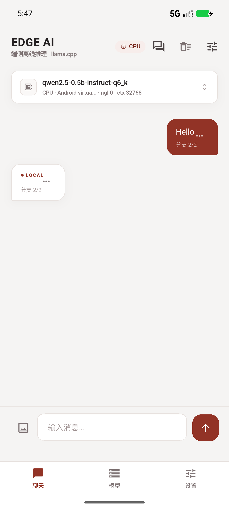
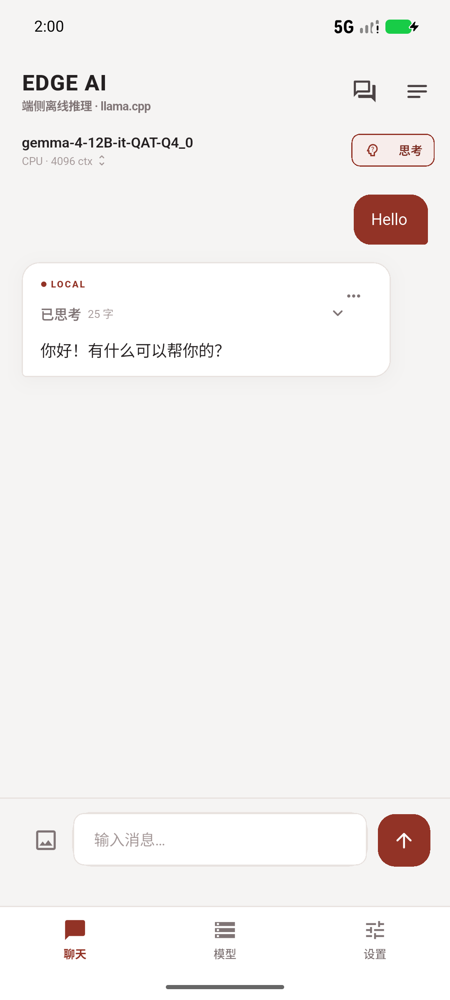
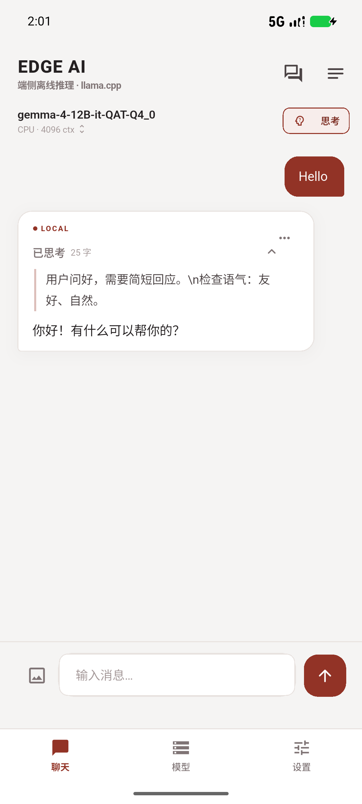
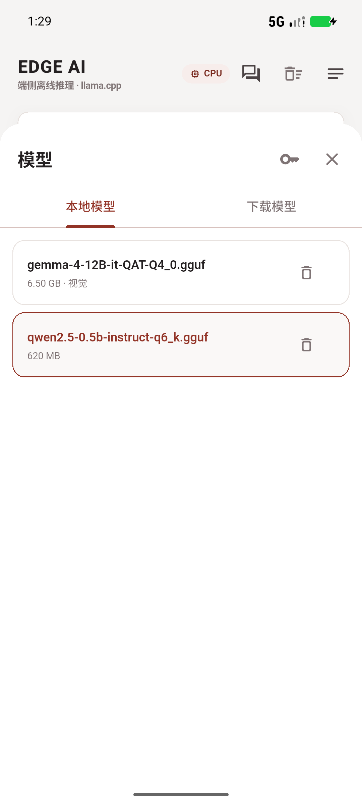
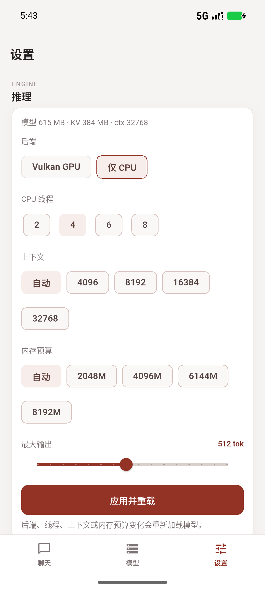
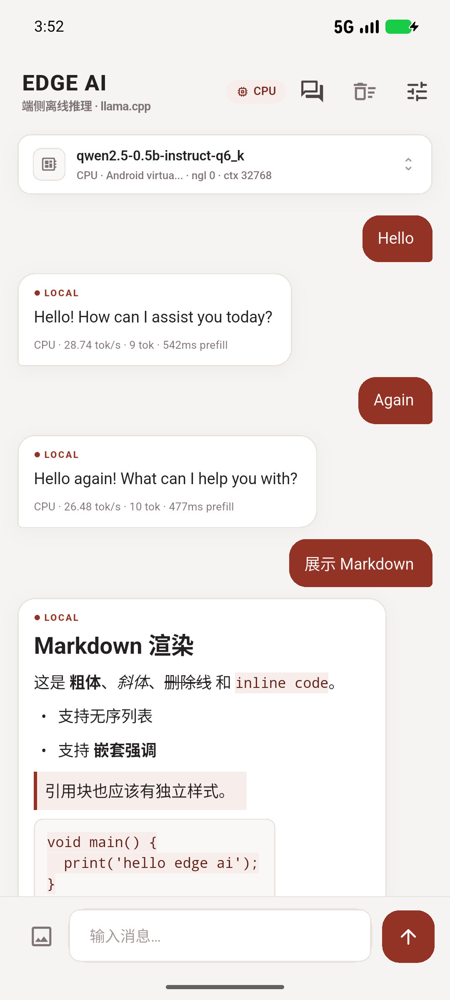
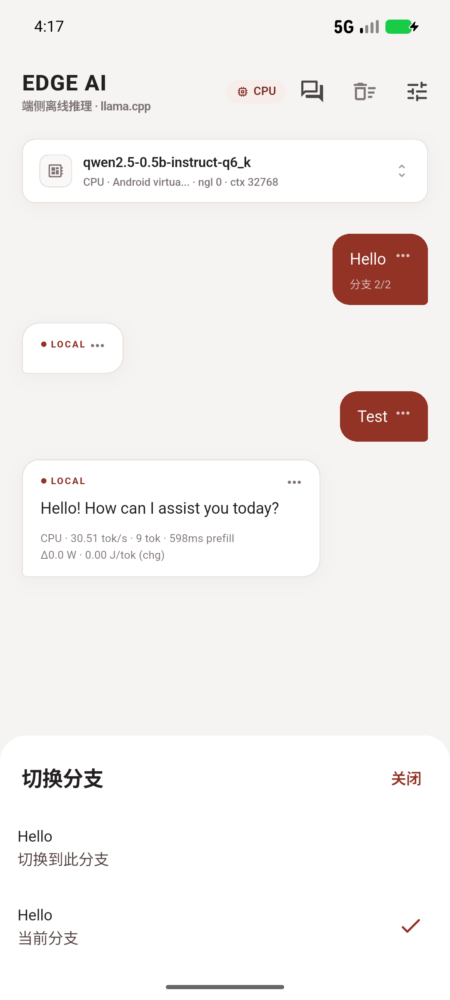
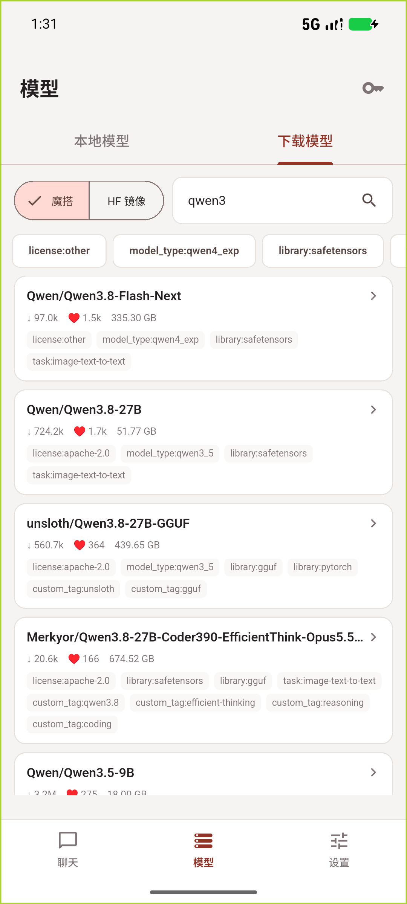

# Edge AI

Flutter + llama.cpp 的 Android 端侧 AI 聊天应用。

推理完全在设备上完成：`libedge_ai.so` 静态链接 llama.cpp 的 **CPU / Vulkan** 后端和 `mtmd` 多模态模块，Dart 通过 FFI 调用。模型加载、生成、KV state 都在独立 isolate 执行，UI 只负责流式展示。

当前 ABI：**v5**。测试模型：`Qwen3-1.7B`；视觉模型：`Gemma 4 12B QAT` + `mmproj`。

## 界面

栗色 (`#923326`) + 暖白画布的轻量卡片风格。主界面为三页底栏，`IndexedStack` 保持聊天和生成状态：

- **聊天**：会话树、分支、Markdown、多图、思考开关、系统提示词
- **模型**：本地模型、Hub 搜索、下载、Token、分片、SHA256
- **设置**：推理参数、KV 缓存、功耗显示；独立页面可滚动

模型在后台加载，不阻塞切换模型/设置；长会话启动后会预加载当前 state。















## 聊天与会话

- 扁平树持久化：消息节点 `id / parentId`，`activeLeafId` 指向当前分支
- 编辑用户消息 → 同一父节点下新建分支
- 重新生成 → 同一提问下新建 assistant 兄弟节点
- 分支切换不删除历史；旧版线性会话自动迁移
- 助手消息右上角 `···`：复制、编辑、重新生成、切换分支
- 用户消息长按打开同一组操作，聊天界面不再常驻多余按钮
- 文本可选中复制；助手 Markdown 与用户纯文本均支持
- 编辑/重新生成会重新标记 assistant 为 streaming，修复了空消息问题

### 思考模式

聊天页模型栏右侧有明确的 **思考** 开关，不再藏在设置里：

- 通过 native Jinja `enable_thinking` 传给模型模板
- 仅对支持该参数的模型生效（Qwen3 等）
- 开关持久化到 `sessions.json`
- 生成过程中仍可继续输入，只是不能发送
- Enter 插入换行，发送使用右侧按钮
- 自动识别 DeepSeek/Qwen 的 think 标记、`<thinking>`、`<|thinking|>`、`[THINK]`、`<reasoning>` 等常见标记
- 思考内容用左侧细线 + 弱化文字单独展示，默认折叠，可展开查看
- 原始标签文本完整保存在会话 JSON 中，渲染时才拆分，不会丢失

### 系统提示词

聊天页右上角“系统提示词”可直接编辑当前会话：

- 留空使用默认提示词
- 修改后删除该会话 state，下一轮全量 prefill
- 会话参数 sheet 里仍保留采样参数与“记住本会话设置”

## KV State 缓存

每个会话只保留**一份当前分支**的 KV state，不为每个分支单独缓存。

- 模型加载完成后自动预加载当前会话 state
- 普通发送、分支切换、编辑、重新生成都做最长公共前缀匹配
- native 用 `llama_memory_seq_rm` 裁掉前缀后的 KV，只 decode 新增 token
- 保存 ctx ≤ 或 > 当前 ctx 都会尝试加载；native 按 state 实际使用的 KV cells 与当前 `n_ctx` 判断，装不下才回退全量 prefill
- 文本 state：token + position
- 多模态 state：`state.bin` + `.meta`（图片 hash、文本 token、M-RoPE positions、`n_past`）
- 默认在磁盘充足时开启，默认上限 4 GB，可调 512 MB–20 GB
- 显示当前占用、一键清理、LRU 淘汰；保存前检查剩余磁盘
- 切换会话时清空 native KV；切回时从 state 文件恢复或重新 prefill

真机实测（1671 prompt）：

```text
state loaded: 1641 tokens, saved ctx 29440, current ctx 32768
state cache prefix hit: 1265/1671
prefill: 约 5 s（修复前约 19 s）
```

> 32k ctx 下 state 文件可能接近 180 MB。预加载和加载耗时随文件增大，但通常仍远小于长历史全量 prefill。

## 模型管理



- 本地 GGUF 扫描、选择、删除；自动配对 `mmproj`
- ModelScope + HuggingFace 镜像（`hf-mirror.com`）搜索
- 搜索结果展示下载量、收藏、更新时间、描述和 tags
- 可点击 tag 过滤结果；文件列表展示真实体积
- 文件体积来自 HF `blobs=true` / LFS size 与 ModelScope `Size`
- 下载进度展示已下载/总量、速度和剩余时间
- 支持取消、断点续传、磁盘预检、SHA256
- 分片 GGUF 自动下载同前缀全部 shard
- Hub Token 入口（ModelScope / HF 分开，用于私有/受限仓库）
- 下载完成自动切换并加载

## 推理与资源

- CPU / Vulkan 双后端，运行时切换
- llama.cpp Jinja chat template，兼容 Qwen、Gemma、Llama 等
- 精确 token 计数、上下文规划、旧消息裁剪、system prompt 保留
- 流式 UTF-8 输出，跨半个汉字/emoji 也能正确拼接
- 停止生成、错误提示、worker isolate 崩溃处理
- 多模态：UI 限制一条消息最多 4 张图 / `mmproj` / M-RoPE
- 自动 ctx：根据当前可用内存推荐，最多 32768
- 低内存时自动降低 ctx，并预留至少 5% 的 KV/graph 余量
- 加载前按模型 + mmproj + headroom 做内存准入
- 后台立即卸载、空闲 10 分钟卸载、内存 watchdog
- 功率、J/tok、耗电量估算；耗电量支持 `Wh` 或电池容量百分比

## 架构

```text
AppShell（底部导航）
  ├─ ChatPage              聊天 / 会话树 / 分支 / Markdown / 思考
  ├─ ModelsPage            本地与 Hub 模型管理
  └─ SettingsPage          推理 / 缓存 / 功耗
       └─ ChatPageController 跨页共享模型状态与设置
Flutter UI
  ├─ SessionStore            扁平树 JSON、state 元数据、全局策略
  ├─ ModelManager            Hub API / 下载 / 校验 / 本地扫描
  └─ InferenceScheduler
       └─ EdgeAiEngine       worker isolate + FFI
            └─ libedge_ai.so
                 ├─ llama.cpp (CPU + Vulkan)
                 └─ mtmd
```

- `app/lib/engine/edge_ai_bindings.dart`：FFI 结构体与函数
- `app/lib/engine/edge_ai.dart`：worker isolate、pull 式 token、UTF-8 流
- `app/lib/engine/scheduler.dart`：单模型常驻、内存准入、卸载策略
- `app/lib/session/session_store.dart`：原子写、扁平树、缓存/显示策略
- `app/lib/models/`：Hub provider、下载器、模型页
- `app/lib/ui/`：主题、组件、聊天页、模型页、设置页
- `native/src/edge_ai.cpp`：C ABI 实现
- `native/include/edge_ai.h`：ABI v5

## 构建

依赖：

| 工具 | 版本/路径 |
| --- | --- |
| Flutter | 3.47.8 |
| Android NDK | `28.2.13676358` |
| CMake | 4.1.2 |
| Vulkan SDK | 1.4.363.0 |
| Visual Studio | 2022 |

脚本默认 Flutter 路径 `D:\App\flutter_sdk\flutter`，换机器需修改 `scripts/*.bat`。

```bat
scripts\build_all.bat
```

分开构建：

```bat
scripts\build_native_android.bat
cd app
flutter build apk --release --target-platform android-arm64
```

AVD / x86_64：

```bat
scripts\build_native_android_x86_64.bat
cd app
flutter build apk --release --target-platform android-x64
```

Native 要点：

- `GGML_VULKAN=ON`、`GGML_CPU=ON`、`GGML_OPENMP=OFF`、`LLAMA_BUILD_MTMD=ON`
- CPU：`-march=armv8.2-a+dotprod+fp16`
- 单产物 `libedge_ai.so`，静态链接 `c++_static`
- `-Wl,-z,max-page-size=16384`，满足 Android 15+ 16 KB page size
- `jniLibs.useLegacyPackaging = true`

测试：

```bat
cd app
flutter analyze
flutter test
```

当前 12 个测试通过：引擎配置/采样参数/上下文规划、3 个会话树迁移/分支测试、6 个思考标签解析测试。

## 运行

```bat
scripts\install_apk.bat
```

模型目录：

```text
/sdcard/Android/data/com.edgeai.edge_ai/files/models
```

推送模型：

```bat
scripts\push_model.bat
```

也可以直接在模型页从 ModelScope / HF 镜像下载。

> 请让 App 自己创建 `models` 目录。用 adb 预先创建的同名目录可能属于 shell，受 scoped storage 影响 App 读不到。

## 发布

GitHub Actions 工作流：`.github/workflows/release.yml`。

- 普通 branch push **不会触发**
- 手动 `workflow_dispatch`，输入 `v0.1.0` 这类版本号
- 或推送 `v*` tag，例如 `git tag v0.1.0 && git push origin v0.1.0`
- 自动编译 arm64 / x86_64 两份 APK，创建 GitHub Release 并上传附件
- `third_party/llama.cpp` 以 submodule 固定到 `aa588a3`，CI 使用 `submodules: recursive`

当前 APK 仍使用 debug 签名；工作流产出用于内部测试/侧载。正式上架前需要配置自己的 release keystore。

## 实测

设备：vivo V2458A / MediaTek MT6991 / Mali-G925-Immortalis MC12 / Android 16 / arm64-v8a。

| 项目 | 结果 |
| --- | --- |
| Vulkan 设备 | Mali-G925-Immortalis MC12 [igpu]，`ngl 99` |
| Qwen3 1.7B Q6_K Vulkan decode | 约 23 tok/s |
| Qwen3 1.7B Q6_K CPU decode | 约 22.8 tok/s（4 threads） |
| Qwen3 1.7B Q6_K Vulkan prefill | 约 1.0–1.4 s |
| Qwen3 1.7B Q6_K CPU prefill | 约 0.8 s |
| Vulkan Q6_K pp512 / tg32 | 92.3 / 26.7 t/s（coopmat off） |
| CPU Q6_K pp512 / tg32 | 96.7 / 27.3 t/s |
| Vulkan 8B Q4_K_M pp256 / tg32 | 23.90 / 9.27 t/s |
| CPU 8B Q4_K_M pp256 / tg32 | 21.36 / 6.73 t/s |
| AVD 12 GB 自动 ctx | 32768，KV 3584 MB，RSS 约 5.4 GB |
| 真机长生成 | 395 tok，22.3 tok/s，8.4 W，0.38 J/tok |
| 后台卸载 | PSS 5.7 GB → 196 MB |
| 真机长会话 state | 1671 prompt，prefix 1265，prefill 约 19 s → **约 5 s** |
| 多模态 state | Gemma 4 12B 单图，prefill 22.4 s → 3.37 s |

> CPU 基准使用单独的 `GGML_VULKAN=OFF` 构建；混合构建里的 `-ngl 0` 仍可能被 Vulkan scheduler 接管。MediaTek 的 Mali coopmat 路径在 Q6_K/Q4_K 下明显慢于标量路径，因此 App 自动设置 `GGML_VK_DISABLE_COOPMAT=1`。

## 目录

```text
app/
  lib/engine/        FFI、worker isolate、scheduler、功耗采样
  lib/models/        Hub 搜索、下载器、模型页
  lib/session/       扁平树会话、原子写、缓存/显示策略
  lib/ui/            主题、组件、聊天页、模型页、设置页
  android/           Android 工程、图标、jniLibs
native/
  include/edge_ai.h  ABI v5
  src/edge_ai.cpp    C ABI 实现
  test/              smoke / vision / vision-state
third_party/
  llama.cpp/         pinned aa588a3
scripts/             构建、安装、模型推送
docs/                SDK / 会话 / 缓存 / 模型 / UI
dist/                已构建 APK 与图标
screenshots/         真机/AVD 截图
```

## 已知限制

- Release APK 仍使用 debug 签名，仅用于内部验证。
- 仅 Android arm64-v8a；没有 iOS/桌面端。
- CPU 库按 armv8.2 + dotprod + fp16 编译，老 ARM 设备可能不兼容。
- MediaTek 默认关闭 Mali coopmat；Adreno 等 GPU 可能需要打开才能发挥矩阵核心。
- 模型目录是 App 私有外部目录，尚未接 SAF 文件选择器。
- 思考开关只通过 Jinja `enable_thinking` 生效；不支持该参数的模板会忽略。
- 分片 GGUF 已实现自动队列，仍需要更多真实分片仓库回归。
- 个别自定义 chat template 仍可能不兼容。
- 每会话只缓存当前分支 state；不缓存其他分支。
- 保存 ctx 大于当前 ctx 时也会尝试加载；仅当实际 KV cells 超过当前 n_ctx 才回退。
- 会话尚未做搜索、重命名、导出、跨设备同步。
- 功耗是电池电流/电压估算；更严谨的测量应使用 USB 功率计。

## 文档

| 文档 | 内容 |
| --- | --- |
| [docs/SDK.md](docs/SDK.md) | C ABI、Dart SDK、资源控制、上下文 |
| [docs/SESSIONS.md](docs/SESSIONS.md) | 扁平树会话、分支、state 绑定 |
| [docs/STATE_CACHE.md](docs/STATE_CACHE.md) | 文本/多模态 KV state、前缀复用、预算 |
| [docs/MODELS.md](docs/MODELS.md) | ModelScope/HF、搜索、下载、校验、分片 |
| [docs/UI.md](docs/UI.md) | 栗色主题、页面、组件、会话树、功耗 |

## 产物

- [edge-ai-arm64.apk](dist/edge-ai-arm64.apk)（约 34.9 MB）
- [edge-ai-x86_64.apk](dist/edge-ai-x86_64.apk)（约 35.1 MB）
- [App 图标](dist/edge-ai-icon.png)
