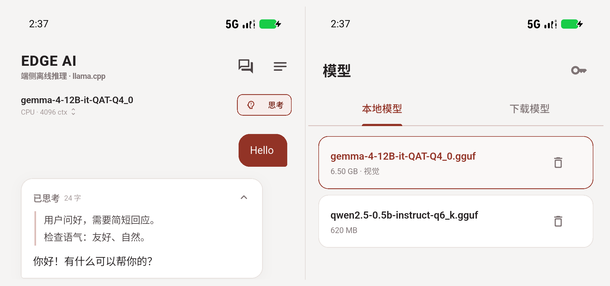

# UI 基线（栗色）

参考 `E:\Workspaces\Rc_App` 的克制、浅色、卡片式框架，保留 Edge AI 自己的模块，但统一到一套栗色体系。

## 颜色

| 角色 | 值 |
| --- | --- |
| 主色 | `#923326` |
| 深主色 | `#7A2A1F` / `#5D1F17` |
| 主色浅底 | `#F7EDEB` |
| 画布 | `#F5F4F3` |
| 卡片 | `#FFFFFF` |
| 卡片浅底 | `#FAF8F7` |
| 主文字 | `#242021` |
| 次文字 | `#7F7475` |
| 分割线 | `#E8E2DF` |
| 危险 | `#B23A3A` |

- 不再使用深色画布 + 青色强调。
- 不再使用装饰性光斑/大面积渐变。
- 用户气泡用主色，助手气泡用白卡 + 细边 + 轻阴影。

## 字体与组件

- `AppText`：display / title / body / small / overline / mono。
- `SurfaceCard`：白底、`#E8E2DF` 细边、轻阴影、`Pressable` 缩放反馈。
- `AppBadge`：主色浅底胶囊，用于 CPU/VULKAN、100% 本地运行。
- `AppPrimaryButton` / `AppSoftButton`：主操作与次操作。
- `AppEmptyBlock`：加载失败、空会话等。
- 设置页、会话 sheet、模型 sheet 统一白底圆角，沿用 Material 3 bottom sheet。

## 顶部

- 顶部只保留文字品牌：`EDGE AI` + “端侧离线推理 · llama.cpp”。
- **不放栗色对话气泡/闪电图形**。
- 功能图标只出现在操作区（会话、清空、设置、图片、发送）。

## App 图标

新图标：白底 + 栗色对话气泡 + 米白点，并带轻微暖色阴影。

- 1024 预览：`dist/edge-ai-icon.png`
- Android legacy mipmap：`mdpi 48` / `hdpi 72` / `xhdpi 96` / `xxhdpi 144` / `xxxhdpi 192`
- Android adaptive：`mipmap-anydpi-v26/ic_launcher.xml` + 分层前景，避免 Pixel 的白色圆环

## Markdown

- 助手消息完成后用 `flutter_markdown` 渲染，流式阶段保持轻量纯文本。
- 支持标题、粗体/斜体/删除线、行内代码、代码块、列表、引用、表格、水平线和链接。
- 代码块独立浅底卡片；链接点击复制 URL；Markdown 图片不发起网络请求，只显示文字占位。
- 用户消息保持纯文本，避免把用户输入的 Markdown 误渲染。

## 会话参数

- 系统提示词、Temperature / Top P / Top K / Repeat penalty、最大输出。
- “记住本会话设置”关闭时只在当前运行期间生效，不写入会话 JSON。
- 系统提示词改变会删除该会话的 KV state，强制下一轮全量 prefill。
- 模型、上下文、线程仍由全局设置控制，变更会触发模型重载。

## 会话树与消息操作

- 会话按扁平树持久化：每个节点有 `id / parentId`，`activeLeafId` 指向当前分支。
- 用户消息可“编辑并新建分支”，助手消息可“重新生成”；旧分支保留。
- 分支在消息气泡右下角显示 `分支 2/3`，点消息右上角 `···` 可复制、编辑、重新生成、切换分支。
- 文本可选中复制（助手 Markdown 与用户纯文本都支持）。
- 每个会话只保留一份当前 KV state；切换分支后下一次生成做前缀匹配，不缓存其他分支。

## 导航与页面

- 三页底栏：**聊天 / 模型 / 设置**，`IndexedStack` 保活，切换不重建会话和生成状态。
- 模型在后台加载；加载期间可以切到模型页或设置页，不再阻塞整个应用。
- 模型页复用完整的本地/Hub 管理界面，选择模型后回到聊天页自动加载。
- 设置页是独立可滚动页面，修掉了旧 bottom sheet 在小屏上滑不到底的问题。

## 全局设置 / 功耗

- 推理：后端、线程、上下文、内存预算、最大输出。
- 缓存：默认开启、上限 512 MB–20 GB，可查看占用并清理。
- 推理统计可独立开关：功率、J/tok、耗电量估算。
- 耗电量单位可选 `Wh` 或 `电池 %`；`电池 %` 按整块电池容量折算，设备不暴露容量时回退为 Wh。
- 模型加载完成后自动预加载当前会话 state；重启后首轮发送走前缀复用，减少长会话冷启动 prefill。

## 间距

- 聊天列表左右 20、底部 24。
- 气泡内边距 16/13，消息间距 8。
- 模型栏、输入栏同步放大边距，避免拥挤。

## 截图

左：聊天与思考内容；右：本地模型管理。

## 待做

- 模型管理页的下载队列/Token 配置收口。
- 会话搜索、重命名。
- 聊天页空态/加载态/错误态的最终统一样式。
- 会话设置仍使用 bottom sheet，后续可收进设置页。

## 思考内容

- 聊天页模型栏右侧的「思考」开关控制 native Jinja `enable_thinking`。
- 输出中的 `...`、`<thinking>`、`<|thinking|>`、`[THINK]`、`<reasoning>` 会被解析成折叠区。
- 折叠标题为「已思考」，生成中为「思考中」；展开后用左侧细线和弱化文字展示。
- 原始标签文本仍完整保存在会话 JSON 中，不修改消息内容。
- Enter 插入换行，发送使用输入框右侧按钮。
